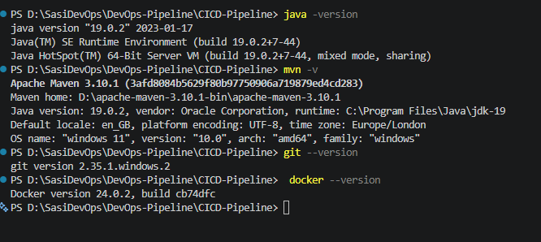
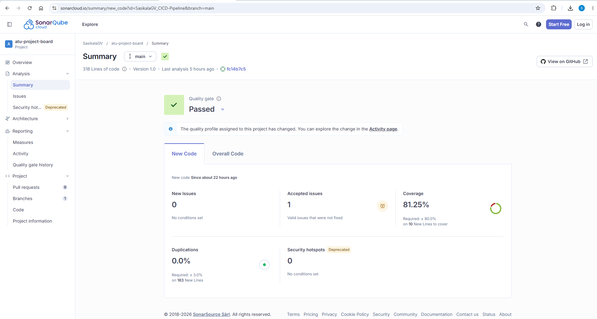
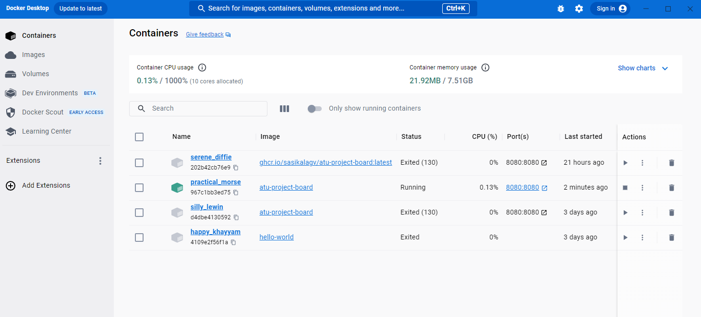
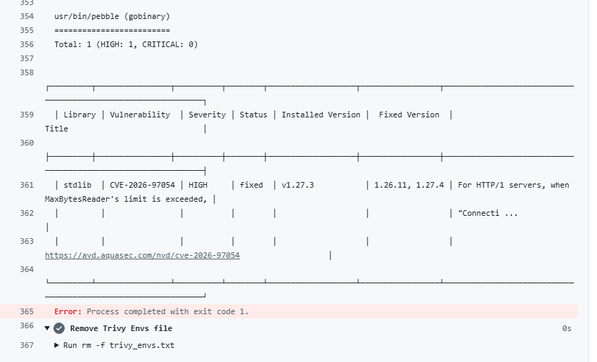
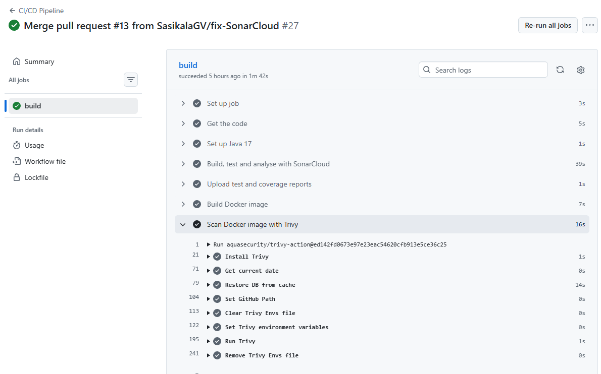
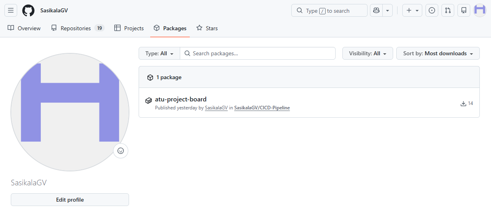
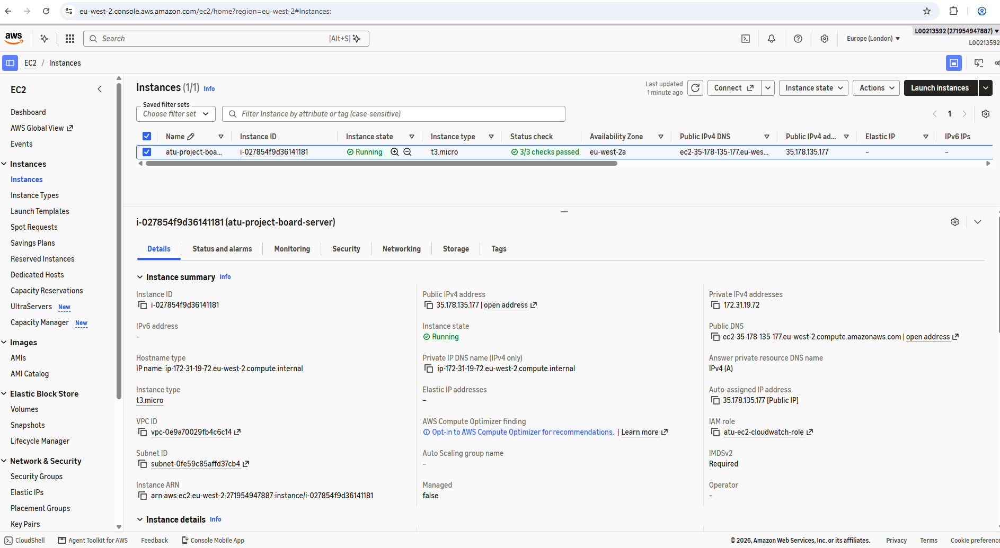
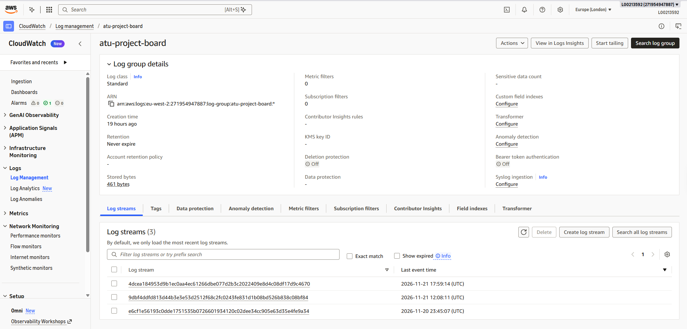
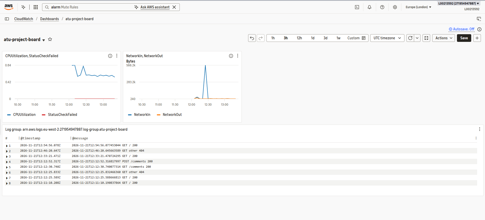
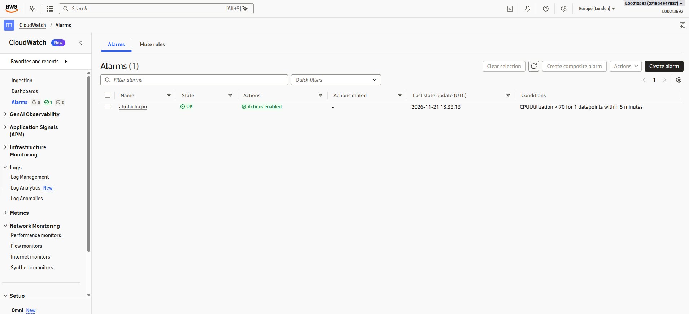

# ATU Project Board – CI/CD Pipeline

A simple Java web application used to demonstrate a complete CI/CD pipeline for the DevOps module (Task 3).

The application has two pages:

- **Home page** (`/`) – student details and a short note about the project
- **Comments page** (`/comments`) – a form for name, email and comment, plus a list of all comments

It uses only the HTTP server built into Java (no frameworks). Comments are kept in memory, so they are cleared when the application restarts (for example after each deployment).

---

## Contents

1. [Pipeline overview](#pipeline-overview)
2. [Tools used](#tools-used)
3. [Project structure](#project-structure)
4. [Requirements](#requirements)
5. [Step 1 – Web application](#step-1--web-application)
6. [Step 2 – Source code management (Git and GitHub)](#step-2--source-code-management-git-and-github)
7. [Step 3 – Automated build and testing (Maven, JUnit, JaCoCo)](#step-3--automated-build-and-testing-maven-junit-jacoco)
8. [Step 4 – Continuous integration (GitHub Actions)](#step-4--continuous-integration-github-actions)
9. [Step 5 – Static code analysis (SonarCloud)](#step-5--static-code-analysis-sonarcloud)
10. [Step 6 – Containerisation (Docker)](#step-6--containerisation-docker)
11. [Step 7 – Security scanning (Trivy)](#step-7--security-scanning-trivy)
12. [Step 8 – Container registry (GitHub Container Registry)](#step-8--container-registry-github-container-registry)
13. [Step 9 – Deployment to AWS EC2](#step-9--deployment-to-aws-ec2)
14. [Step 10 – Monitoring and logging (AWS CloudWatch)](#step-10--monitoring-and-logging-aws-cloudwatch)
15. [Complete workflow file](#complete-workflow-file)
16. [Problems found and how they were solved](#problems-found-and-how-they-were-solved)
17. [Known limitations and future work](#known-limitations-and-future-work)
18. [Cleaning up AWS resources](#cleaning-up-aws-resources)

---

## Pipeline overview

```
 Developer (VS Code)
        │  git push (feature branch) + pull request
        ▼
 GitHub repository ─────────────────────────────► SonarCloud (PR check + quality gate)
        │
        ▼
 GitHub Actions – CI/CD Pipeline
   1. Checkout code
   2. Set up Java 17
   3. Maven build + 15 JUnit tests + JaCoCo coverage + SonarCloud analysis
   4. Upload test and coverage reports (artifact)
   5. Build Docker image
   6. Trivy security scan  ── fails pipeline on HIGH/CRITICAL fixable vulnerabilities
        │
        │  (only after merge to main)
        ▼
   7. Push image to GitHub Container Registry (ghcr.io)
   8. Deploy to AWS EC2 over SSH (pull image, restart container)
   9. Check the live website responds
        │
        ▼
 AWS EC2 (Docker container, port 80)
        │  container logs + EC2 metrics
        ▼
 AWS CloudWatch – log group, dashboard, CPU alarm → email (SNS)
```

| Brief stage | Tool used | Status |
|---|---|---|
| Source code management | Git, GitHub, VS Code | Done |
| Automated builds and testing | Maven, JUnit 5, JaCoCo, GitHub Actions | Done |
| Static code analysis | SonarCloud (SonarQube Cloud) | Done |
| Security scanning | Trivy | Done |
| Containerisation | Docker, GitHub Container Registry | Done |
| Deployment to a cloud platform | AWS EC2 | Done |
| Monitoring and logging | AWS CloudWatch (Logs, Dashboard, Alarms, SNS) | Done |

---

## Tools used

| Pipeline stage (module diagram) | Tool |
|---|---|
| Commit change | Git, GitHub, VS Code |
| Trigger build | `git push` and pull requests trigger GitHub Actions |
| Build | Maven |
| Notify of build outcome | GitHub Actions status checks on the pull request and Actions tab |
| Run tests | JUnit 5 (unit and integration tests) |
| Notify of test outcome | Maven Surefire reports, JaCoCo coverage report, SonarCloud PR comment |
| Deploy to production | Docker, GitHub Container Registry, AWS EC2 |
| Monitor | AWS CloudWatch, email alerts through Amazon SNS |

---

## Project structure

```
CICD-Pipeline/
├── .github/
│   └── workflows/
│       └── maven.yml              (GitHub Actions CI/CD pipeline)
├── images/                        (screenshots used in this README / report)
├── src/
│   ├── main/java/ie/atu/projectboard/
│   │   ├── App.java               (starts the server, handles the pages, request logging)
│   │   ├── Pages.java             (builds the HTML, validation, student details)
│   │   └── Comment.java           (one comment: name, email, text)
│   └── test/java/ie/atu/projectboard/
│       ├── AppTest.java           (7 unit tests)
│       └── AppIntegrationTest.java (8 integration tests – real GET and POST requests)
├── Dockerfile
├── pom.xml
├── .gitignore
├── LICENSE
└── README.md
```

---

## Requirements

| Tool | Version used |
|---|---|
| Java | Java 19 locally; the build targets Java 17 |
| Maven | 3.10.x |
| Git |  2.35.1.windows.2 |
| Docker Desktop | Docker 24.0.2 |
| VS Code | with the Extension Pack for Java |

Accounts used: GitHub, SonarCloud (signed in with GitHub), AWS (free account).

Check the local tools:

```
java -version
mvn -v
git --version
docker --version
```

---

## Step 1 – Web application

A simple Java web application was created:

- `App.java` – starts a web server using `com.sun.net.httpserver.HttpServer` and handles `/` and `/comments`. The `startServer(port)` method returns the server so tests can start and stop it. `main()` runs it on port 8080.
- `Pages.java` – builds the HTML for each page, validates the comment form (name required, email must contain `@`, comment required) and escapes user input to prevent HTML/JavaScript injection.
- `Comment.java` – stores one comment.

Student details are set at the top of `Pages.java`.

Run locally:

```
mvn clean package
java -jar target/atu-project-board.jar
```

Open http://localhost:8080. Press `Ctrl + C` to stop.


---

## Step 2 – Source code management (Git and GitHub)

The project folder was connected to a GitHub repository using GitHub clone in Visual Studio code clone using https://github.com/SasikalaGV/CICD-Pipeline.git 


**Branching approach:** each pipeline stage was developed on its own branch and merged into `main` through a pull request. Every pull request runs the pipeline and the SonarCloud check before it can be merged, and the repository history shows the project being built up stage by stage.

```
git checkout main
git pull origin main
git checkout -b <feature-webpage>
# make and test changes
git add .
git commit -m "Added webpage and GitHub action workflow"
git push -u origin <feature-webpage>
# open a pull request on GitHub, check it passes, then merge
```

The `target/` folder is excluded by `.gitignore`, so build output is never committed.

---

## Step 3 – Automated build and testing (Maven, JUnit, JaCoCo)

`pom.xml` defines:

- Java 17 as the compile target
- JUnit 5 (`junit-jupiter`) for tests
- `maven-surefire-plugin` to run the tests and produce test reports
- `maven-jar-plugin` to build a runnable jar, `target/atu-project-board.jar`
- `jacoco-maven-plugin` to measure test coverage and produce an HTML/XML report in `target/site/jacoco/`

### Tests (15 in total)

**Unit tests – `AppTest.java` (7)** call the page and helper methods directly:

- the home page shows the student details and project note
- the comments page has the name, email and comment fields
- submitted comments are listed on the page
- validation accepts good input and rejects missing or invalid input
- HTML in user input is escaped
- submitted form data is parsed correctly

**Integration tests – `AppIntegrationTest.java` (8)** start the real server on a free port and send real HTTP requests with Java's `HttpClient`:

| Test | Request | Checks |
|---|---|---|
| getHomePageReturnsStudentDetails | GET `/` | status 200, student details, HTML content type |
| getCommentsPageShowsForm | GET `/comments` | status 200, form shown |
| getUnknownPageReturns404 | GET `/does-not-exist` | status 404 |
| postValidCommentIsSavedAndShown | POST, then GET | thank-you message, comment still shown |
| postWithoutNameShowsError | POST with empty name | error message |
| postWithBadEmailShowsError | POST with invalid email | error message |
| postWithEmptyBodyShowsError | POST with no data | error message |
| postedHtmlIsEscaped | POST `<script>` in comment | shown as text, not run |

Build and test locally:

```
mvn clean package
```

Expected: `Tests run: 15, Failures: 0, Errors: 0` and `BUILD SUCCESS`.

Coverage report: open `target/site/jacoco/index.html` in a browser.


### Coverage

With unit tests only, JaCoCo reported 60% instruction coverage and 58% branch coverage. App was only 30% covered, because the server start-up and request handlers never ran during unit tests. After adding 8 integration tests that start the real server and send real GET and POST requests, total coverage rose to 95% of instructions and 85% of branches. App rose from 30% to 94%. This also meets SonarCloud's requirement of at least 80% coverage on new code.

---

## Step 4 – Continuous integration (GitHub Actions)

The workflow is in `.github/workflows/maven.yml` (full file [below](#complete-workflow-file)). It runs:

- on every **pull request** into `main` – build, tests, SonarCloud, Docker build and Trivy scan
- on every **push to `main`** (after a merge) – all of the above, plus pushing the image and deploying to AWS

The result of every run (green tick or red cross) is shown on the pull request and in the **Actions** tab. GitHub can also email the person who triggered a run (GitHub → Settings → Notifications → Actions).

**Test and coverage reports** are uploaded as a run artifact called `maven-reports` (Surefire reports and the JaCoCo report). They can be downloaded from the run's Summary page. `if: always()` means the reports are uploaded even when tests fail.


---

## Step 5 – Static code analysis (SonarCloud)

SonarCloud (now called SonarQube Cloud) analyses the Java code for bugs, vulnerabilities, code smells, duplication and coverage. It is free for this project.

### Setup

1. Signed in to https://sonarcloud.io with GitHub and imported the repository (Free plan).
2. Chose **With GitHub Actions** as the analysis method.
3. Stored the SonarCloud token as a GitHub secret named `SONAR_TOKEN` (Settings → Secrets and variables → Actions).
4. Turned **Automatic Analysis off** (Administration → Analysis Method), because only one analysis method can be used at a time.
5. Added the SonarScanner for Maven to the build step:

```yaml
      - name: Build, test and analyse with SonarCloud
        env:
          SONAR_TOKEN: ${{ secrets.SONAR_TOKEN }}
        run: >
          mvn -B clean verify
          org.sonarsource.scanner.maven:sonar-maven-plugin:5.9.0.7382:sonar
          -Dsonar.host.url=https://sonarcloud.io
          -Dsonar.organization=<organization-key>
          -Dsonar.projectKey=<project-key>
```

- `fetch-depth: 0` is set on checkout so SonarCloud can tell new code from old code.
- The plugin version is pinned (`5.9.0.7382`) so the analysis behaves the same on every run.
- SonarCloud reads the JaCoCo report, so coverage appears on its dashboard.

### Quality gate

SonarCloud's default quality gate ("Sonar way") checks new code. It requires a Security Rating of A, at least 80% coverage, and no more than 3% duplication. SonarCloud posts the result on every pull request.

First result on `main`: **Quality Gate passed** – 0 issues, 0.0% duplication, 57% coverage, 274 lines of code.



The quality gate failed three times during the project, and each time pointed to a real problem (see [Problems found](#problems-found-and-how-they-were-solved)).

---

## Step 6 – Containerisation (Docker)

The `Dockerfile` packages the jar that Maven builds into a small container image:

```dockerfile
# Small Java 17 runtime image (Alpine Linux)
FROM eclipse-temurin:17-jre-alpine

# Folder inside the container
WORKDIR /app

# Copy the jar that Maven built
COPY target/atu-project-board.jar app.jar

# The app listens on port 8080
EXPOSE 8080

# Start the app
CMD ["java", "-jar", "app.jar"]
```

Build and run locally:

```
mvn clean package
docker build -t atu-project-board .
docker run -p 8080:8080 atu-project-board
```


---

## Step 7 – Security scanning (Trivy)

After the image is built, Trivy scans it for known vulnerabilities in the operating system packages, the application jar and any other binaries:

```yaml
      - name: Scan Docker image with Trivy
        uses: aquasecurity/trivy-action@ed142fd0673e97e23eac54620cfb913e5ce36c25 # v0.36.0
        with:
          image-ref: ghcr.io/sasikalagv/atu-project-board:latest
          format: table
          severity: CRITICAL,HIGH
          ignore-unfixed: true
          exit-code: "1"
```

- `severity: CRITICAL,HIGH` – report only serious vulnerabilities
- `ignore-unfixed: true` – ignore vulnerabilities that have no fix yet
- `exit-code: "1"` – **fail the pipeline** if one is found (a security gate), so a vulnerable image is never pushed or deployed

**Pinning:** the Trivy action is pinned to a full commit SHA instead of a version tag. In March 2026 many `aquasecurity/trivy-action` tags were force-pushed to malicious code in a supply-chain attack. Pinning to the reviewed commit of `v0.36.0` (checked against the official releases page) means the pipeline always runs that exact code.




### Finding: CVE-2026-97054

With the original base image `eclipse-temurin:17-jre` (Ubuntu 26.04), Trivy failed the pipeline:

| Target | Type | Vulnerabilities |
|---|---|---|
| atu-project-board:latest (ubuntu 26.04) | ubuntu | 0 |
| app/app.jar | jar | 0 |
| usr/bin/pebble | gobinary | 1 |

| Library | Vulnerability | Severity | Installed | Fixed in |
|---|---|---|---|---|
| stdlib (Go) | CVE-2026-97054 | HIGH | v1.27.3 | 1.26.11, 1.27.4 |

My own application jar came back clean. The problem was in /usr/bin/pebble, a small Go program that was already inside the base image. It had been built with an older version of Go's standard library, so it wasn't something I could update from my project.

To fix it, I switched the base image to eclipse-temurin:17-jre-alpine. I tested the app locally to make sure it still worked, pushed the change, and this time the Trivy scan passed. It was useful to see the security gate work both ways: first it stopped a vulnerable image from going any further, and then it let the build through once the problem was fixed..


---

## Step 8 – Container registry (GitHub Container Registry)

After the Trivy scan passes, the image is pushed to GitHub Container Registry so the AWS server can download it:

```yaml
      - name: Push image to GitHub Container Registry
        if: github.event_name == 'push' && github.ref == 'refs/heads/main'
        env:
          GHCR_TOKEN: ${{ secrets.GITHUB_TOKEN }}
          GHCR_USER: ${{ github.actor }}
        run: |
          echo "$GHCR_TOKEN" | docker login ghcr.io -u "$GHCR_USER" --password-stdin
          docker push ghcr.io/sasikalagv/atu-project-board:latest
```

This step only runs after a pull request has been merged into main, so nothing gets published while changes are still being reviewed. I didn't need to set up an extra account or password for it: GitHub gives each workflow run its own temporary GITHUB_TOKEN, and I gave the workflow permission to write packages (permissions: packages: write).

At first I wrote the token directly into the shell command, but SonarCloud flagged that as a security issue. I changed it to pass the token in through env: instead, which keeps it safely out of the script itself.

Finally, I made the package public (GitHub profile → Packages → atu-project-board → Package settings → Change visibility), so my EC2 server can download the image without having to log in.

Image name: `ghcr.io/sasikalagv/atu-project-board:latest` (registry names must be lowercase).
You can find it on GitHub under the **Packages** tab of my profile, or download and run it with:
`docker pull ghcr.io/sasikalagv/atu-project-board:latest`




---

## Step 9 – Deployment to AWS EC2

### One-time server setup

1. **Region:** Europe (London) `eu-west-2`.
2. **Launched an EC2 instance:**
   - AMI: Amazon Linux 2023
   - Instance type: `t3.micro` (free-tier eligible; x86, matching the image built by GitHub Actions)
   - Key pair: new RSA key, `.pem` format (kept private, never committed)
   - Security group: SSH (port 22) and HTTP (port 80) allowed from anywhere




3. **Installed Docker** (connected with EC2 Instance Connect in the browser):

   ```
   sudo dnf install -y docker
   sudo systemctl enable --now docker
   sudo usermod -aG docker ec2-user
   ```

4. **First manual run** to check the setup:

   ```
   docker run -d --name atu-project-board -p 80:8080 --restart unless-stopped ghcr.io/sasikalagv/atu-project-board:latest
   ```


   The site opened at `http://35.178.135.177`.


### Automatic deployment

Three GitHub secrets were added: `EC2_HOST` (public IP), `EC2_USER` (`ec2-user`) and `EC2_SSH_KEY` (contents of the `.pem` file).

After every merge to `main` – and only if the build, tests, SonarCloud analysis and Trivy scan all passed – the pipeline connects to the server over SSH, downloads the new image and restarts the container:

```yaml
      - name: Deploy to AWS EC2
        if: github.event_name == 'push' && github.ref == 'refs/heads/main'
        env:
          SSH_KEY: ${{ secrets.EC2_SSH_KEY }}
          EC2_HOST: ${{ secrets.EC2_HOST }}
          EC2_USER: ${{ secrets.EC2_USER }}
        run: |
          echo "$SSH_KEY" > key.pem
          chmod 600 key.pem
          ssh -i key.pem -o StrictHostKeyChecking=no $EC2_USER@$EC2_HOST "
            docker pull ghcr.io/sasikalagv/atu-project-board:latest &&
            (docker rm -f atu-project-board || true) &&
            docker run -d --name atu-project-board -p 80:8080 --restart unless-stopped --log-driver=awslogs --log-opt awslogs-region=eu-west-2 --log-opt awslogs-group=atu-project-board --log-opt awslogs-create-group=true ghcr.io/sasikalagv/atu-project-board:latest &&
            docker image prune -f
          "
          rm -f key.pem

      - name: Check the live website
        if: github.event_name == 'push' && github.ref == 'refs/heads/main'
        env:
          EC2_HOST: ${{ secrets.EC2_HOST }}
        run: |
          sleep 10
          curl -f http://$EC2_HOST/
```

During each deployment, docker rm -f stops and removes the old container, so the new one can start in its place. I also added docker image prune -f to clear out old images. The EC2 server only has a small disk, and without this the old images would slowly fill it up.

The SSH key is only written to the GitHub runner for as long as the deploy needs it, and it's deleted straight afterwards. As a final check, the pipeline requests the home page of the live site. If the site doesn't respond, the step fails, so a broken deployment shows up as a red cross instead of going unnoticed.

One thing I had to remember: the EC2 public IP address changes every time I stop and start the instance. Before deploying again, I have to update the EC2_HOST secret with the new address, otherwise the deploy step can't reach the server.


---

## Step 10 – Monitoring and logging (AWS CloudWatch)

### Request logging in the application
I added logging to App.java so the app writes a line for every request, and another whenever someone adds a comment. In the logs it looks like this:

2026-11-21T12:12:52.316817997 POST /comments 200
New comment added. Total comments: 1

I was careful about what goes into these logs. The app only records values it already knows: the page (/, /comments or other) and the method (GET or POST). It never writes the raw web address or anything typed into the form. That way, nobody can sneak fake lines into my logs by sending a strange request, which is known as log injection. It also means people's names and email addresses never end up in the logs.


### Sending container logs to CloudWatch

1. **IAM role:** created `atu-ec2-cloudwatch-role` (trusted entity: EC2, policy: `CloudWatchAgentServerPolicy`) and attached it to the instance (Actions → Security → Modify IAM role). The server can write to CloudWatch without storing any credentials.


2. **Docker log driver:** the deploy step runs the container with `--log-driver=awslogs`, which sends everything the application prints to the CloudWatch log group `atu-project-board` in `eu-west-2`. The log group is created automatically.

Logs: CloudWatch → Logs → Log Management → `atu-project-board`.


### Dashboard

A CloudWatch dashboard, `atu-project-board`, shows:

- **EC2 metrics:** `CPUUtilization`, `NetworkIn`, `NetworkOut`, `StatusCheckFailed`
- **Logs table:** recent requests, using this query:

```
fields @timestamp, @message
| filter @message like /POST|GET/
| sort @timestamp desc
| limit 20
```

The `NetworkIn` spike visible after a merge is the server downloading the new Docker image during deployment.



### Alarm and email notification
I also set up an alarm called atu-high-cpu, which keeps an eye on the server's CPU usage. If CPU goes above 70% within any five-minute period, the alarm goes off. When that happens, it sends a message through an Amazon SNS topic I created called atu-alerts, which emails me straight away. AWS doesn't send these emails until you confirm the subscription, so I clicked the confirmation link in the email AWS sent me first.



When I changed the condition to the CPU Utilization greater than 0.1 just to get the failure email and I got that in a minute. 


---


## Cleaning up AWS resources

To avoid charges after the assignment:

1. EC2 → Instances → **Stop** the instance when not in use, or **Terminate** it when finished.
2. CloudWatch → delete the alarm `atu-high-cpu`, the dashboard `atu-project-board` and the log group `atu-project-board`.
3. SNS → delete the topic `atu-alerts`.
4. IAM → delete the role `atu-ec2-cloudwatch-role`.
5. EC2 → Key pairs → delete `atu-key`, and remove the `EC2_*` secrets from GitHub.
